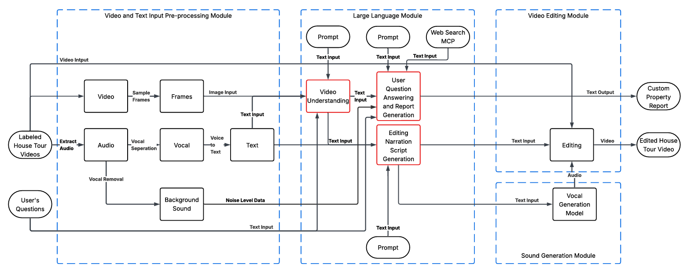

# Video and Text Input Pre processing Module
This repository contains the Video-and-Text-Input-Pre-processing-Module, a core component of the VRLook Software Flow system. This microservice is designed to accept a single video file (e.g., a house tour video) and process it to extract the three key inputs required by the downstream Large Language Module: Text Input (Transcription), Image Input (Video Frames), and Noise Level Data. 

This service is built using FastAPI for the web server and Docker to containerize all complex dependencies like ffmpeg, demucs, and transformers.

## Pipeline Overview
When a video is sent to the /preprocess-video/ endpoint, it triggers a multi-stage pipeline:

1. Extract Video Frames: Uses OpenCV (cv2) to capture video frames at 2-second intervals. Each frame is encoded as a Base64 string.
2. Extract Audio: Uses ffmpeg to extract the full audio track from the video as a .wav file.
3. Vocal Separation: Uses demucs (model: htdemucs_ft) to separate the audio into four stems: vocals, bass, drums, and other.
4. Transcribe Vocals: The isolated vocals.wav file is fed into an Automatic Speech Recognition (ASR) model (openai/whisper-large-v3-turbo) to generate a clean text transcription.
5. Analyze Background Noise: The non-vocal stems (bass, drums, other) are merged into a single "background.wav" file. This file is then analyzed with librosa to calculate the mean Root Mean Square (RMS) energy, which represents the noise_level.

The service then returns these three distinct outputs in a single JSON response.

## Setup and Installation
This project is designed to run inside a Docker container.
### Prerequisites
* Docker Desktop: Must be installed and running.
* NVIDIA GPU (Recommended): Both Whisper (transcription) and Demucs (audio separation) are computationally intensive. Running this container with GPU access is highly recommended for reasonable processing times.
* NVIDIA Docker: If using a GPU, ensure you have the NVIDIA Container Toolkit installed so Docker can access the GPU.
### Running the Service
1. Build the Docker Image: From the root directory (where the Dockerfile is), run:
```
docker build -t video-preprocessor .
```
This will take several minutes as it installs ffmpeg, torch, demucs, and torchcodec.
2. Run the Docker Container: To run with GPU acceleration (recommended):
```
docker run -d -p 8001:8001 --gpus=all --name vlook_preprocessor video-preprocessor
```
If you do not have an NVIDIA GPU, you can run it on the CPU, but it will be very slow:
```
docker run -d -p 8001:8001 --name vlook_preprocessor video-preprocessor
```
3. Check Service Startup: The service must download and load the large Whisper model on its first run. This can take 5-10 minutes. You can watch the progress in real-time:
```
docker logs -f vlook_preprocessor
```
Do not proceed until you see the log INFO: Application startup complete.
4. Verify Service: Once startup is complete, open your browser to http://localhost:8001/docs. You will see the FastAPI interactive (Swagger) documentation.

## API Usage
This service provides one main endpoint.

`POST /preprocess-video/`

This is the primary endpoint for processing a video.

* Request: `multipart/form-data` You must upload a file under the file field.

* `curl` Example:
```
curl -X POST "http://localhost:8001/preprocess-video/" \
     -H "accept: application/json" \
     -H "Content-Type: multipart/form-data" \
     -F "file=@/path/to/your/house_tour.mp4"
```
* Success Response (200 OK): The service returns a JSON object matching the `PreprocessingResponse` model. This JSON is the direct input for the next module.

Response JSON Structure:
```
{
  "transcribed_text": "Welcome to this beautiful three-bedroom home...",
  "base64_frames": [
    "/9j/4AAQSk... (base64 string for frame 1)",
    "/9j/4AAQSk... (base64 string for frame 2)",
    "/9j/4AAQSk... (base64 string for frame 3)"
  ],
  "noise_level": 0.0023
}
```

## Connecting to the Large Language Module
As shown in the VRLook Software Flow, this module's outputs are the direct inputs for the Large Language Module (LLM). The connection is a simple HTTP API call.

Your LLM service (the next module you build) will act as an HTTP client. When it needs to process a video, it will perform the following steps:

1. Read the source video file (e.g., house_tour.mp4).
2. Make an HTTP POST request to this pre-processing service (which is running at http://vlook_preprocessor:8001/preprocess-video/). Note: When services are in the same Docker network, you should use the container name (vlook_preprocessor) as the hostname instead of localhost.
3. Send the video file as multipart/form-data.
4. Receive the JSON response (shown above).
5. Use the JSON data to feed the LLM.

How the JSON maps to the LLM (VRLook Software Flow.pdf)

* transcribed_text ➡️ Text Input: This string is fed directly into the "Video Text Understanding Input" and the "User Question Answering" blocks.
* base64_frames ➡️ Image Input: This is a list of Base64-encoded strings. Your LLM service (likely a multimodal model like GPT-4o) will need to loop over this list, decode each string back into an image, and pass them to the "Video Text Understanding Input" block.
* noise_level ➡️ Noise Level Data : This float value is fed into the "User Question Answering" block, likely to provide context about the audio quality (e.g., "The audio was noisy, so the transcription may have errors").

Example: Python Code for your LLM Service

Here is an example of how your Large Language Module (written in Python) would call this service:
``` python
import requests
import json

# This is the path to the video you want to process
video_file_path = "path/to/my_house_tour.mp4"

# This is the URL of your pre-processing service
# Use the Docker container name if running in a shared Docker network
# Use localhost if testing from your host machine
PREPROCESSOR_URL = "http://localhost:8001/preprocess-video/"

# Open the video file in binary-read mode
with open(video_file_path, "rb") as f:
    files_data = {
        "file": (video_file_path, f, "video/mp4")
    }
    
    try:
        print(f"Sending {video_file_path} to pre-processor...")
        # Make the API call
        response = requests.post(PREPROCESSOR_URL, files=files_data, timeout=600) # 10 min timeout
        
        response.raise_for_status()  # Raise an exception for bad status codes
        
        # Get the JSON data
        data = response.json()
        
        # --- You now have all the data for the LLM ---
        
        transcribed_text = data.get("transcribed_text")
        base64_frames_list = data.get("base64_frames")
        noise_level = data.get("noise_level")
        
        print(f"Successfully processed video.")
        print(f"Transcription: {transcribed_text[:50]}...")
        print(f"Frames received: {len(base64_frames_list)}")
        print(f"Noise Level: {noise_level:.4f}")

        # Now, you can pass this data to your multimodal LLM
        # e.g., result = my_llm_client.chat(
        #     text=transcribed_text,
        #     images=base64_frames_list 
        # )

    except requests.exceptions.RequestException as e:
        print(f"Error calling pre-processing service: {e}")
    except KeyError as e:
        print(f"Error: Response JSON was missing a key: {e}")
```
